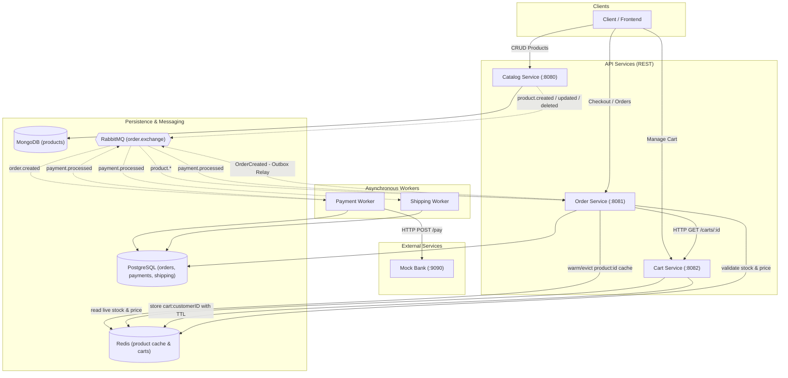

# RedWeb — Event-Driven E-Commerce Microservices

[](https://golang.org)
[](https://en.wikipedia.org/wiki/Hexagonal_architecture_(software))
[](https://www.rabbitmq.com)
[](https://www.postgresql.org)
[](https://gateway-api.sigs.k8s.io)
[](LICENSE)

**RedWeb** is a production-grade, event-driven e-commerce backend built with Go, implementing **Hexagonal Architecture (Ports & Adapters)**, the **Transactional Outbox Pattern**, distributed **Idempotency**, and event-driven data projection.

---

## Table of Contents

- [1. System Architecture](#1-system-architecture)
- [2. Microservices Overview](#2-microservices-overview)
- [3. Getting Started & Local Development](#3-getting-started--local-development)
  - [Prerequisites](#prerequisites)
  - [Step 1: Start Infrastructure](#step-1-start-infrastructure)
  - [Step 2: Service Startup Order](#step-2-service-startup-order)
- [4. Complete API Reference](#4-complete-api-reference)
  - [Catalog Service (`:8080`)](#catalog-service-8080)
  - [Cart Service (`:8082`)](#cart-service-8082)
  - [Order Service (`:8081`)](#order-service-8081)
  - [Mock Bank (`:9090`)](#mock-bank-9090)
- [5. End-to-End Purchase Lifecycle](#5-end-to-end-purchase-lifecycle)
- [6. Testing & Quality Assurance](#6-testing--quality-assurance)
- [7. Kubernetes & GitOps Deployment](#7-kubernetes--gitops-deployment)
  - [Architecture Topology](#architecture-topology)
  - [Deployment with Kustomize](#deployment-with-kustomize)
  - [ArgoCD Integration](#argocd-integration)
- [8. Architectural Design Patterns](#8-architectural-design-patterns)

---

## 1. System Architecture



---

## 2. Microservices Overview

| Service | Type | Port | Storage / Infrastructure | Responsibility |
|---|---|---|---|---|
| **`catalog-service`** | REST API | `8080` | MongoDB (`catalog_db`), RabbitMQ | Product catalog management, emits mutation events (`product.created`, `product.updated`, `product.deleted`). |
| **`cart-service`** | REST API | `8082` | Redis | Customer shopping cart management with 7-day TTL, live price and stock validation from Redis cache. |
| **`order-service`** | REST API + Worker | `8081` | PostgreSQL (`order_db`), Redis, RabbitMQ | Order creation via cart checkout, transactional outbox event relay, order cancellation, and catalog event caching. |
| **`payment-service`** | Worker | — | PostgreSQL (`payment_db`), Redis, RabbitMQ | Consumes `order.created`, enforces Redis distributed idempotency lock, charges Mock Bank, emits `payment.processed`. |
| **`shipping-service`** | Worker | — | PostgreSQL (`shipping_db`), RabbitMQ | Consumes `payment.processed`, automatically creates shipment tracking for successful payments. |
| **`mock-bank`** | HTTP Service | `9090` | In-memory | Simulates payment gateway with 100–500ms network latency and an 80% success / 20% failure distribution. |

---

## 3. Getting Started & Local Development

### Prerequisites

- **Go:** 1.25+ or 1.26+ installed
- **Docker & Docker Compose:** for local dependencies
- **Make:** for executing automation targets
- **curl & jq:** for manual testing and scripting

### Step 1: Start Infrastructure

Start PostgreSQL, MongoDB, Redis, and RabbitMQ via Docker Compose:

```bash
make up
# Or: docker compose -f docker-compose.external.yml up -d
```

Initialize the PostgreSQL databases for payment and shipping services:

```bash
docker exec RedWeb-postgres psql -U postgres -c "CREATE DATABASE payment_db;"
docker exec RedWeb-postgres psql -U postgres -c "CREATE DATABASE shipping_db;"
```

> **Note:** RabbitMQ default credentials in Docker are `guest:guest`. Management UI is available at `http://localhost:15672`.

### Step 2: Service Startup Order

> **Important:** Start `order-service` before creating products in `catalog-service`. RabbitMQ requires the queue `order.product.cache.queue` to be bound to receive `product.created` events and warm the Redis cache (`product:{id}`).

Run each service in a separate terminal:

```bash
# Terminal 1: Order Service (runs HTTP API & Outbox Relay)
make run-order

# Terminal 2: Catalog Service
make run-catalog

# Terminal 3: Cart Service
make run-cart

# Terminal 4: Mock Bank
make run-mockbank

# Terminal 5: Payment Worker
make run-payment

# Terminal 6: Shipping Worker
make run-shipping
```

---

## 4. Complete API Reference

### Catalog Service (`:8080`)

Base URL: `http://localhost:8080`

#### 1. Create Product
- **Method:** `POST /api/v1/products`
- **Request Body:**
  ```json
  {
    "name": "Mechanical Keyboard",
    "description": "RGB Blue Switch",
    "price": 89.99,
    "stock": 15
  }
  ```
- **Response (`201 Created`):**
  ```json
  {
    "id": "c7a8e0f1-4c28-4e89-b1d5-987d6e4a2b1c",
    "name": "Mechanical Keyboard",
    "description": "RGB Blue Switch",
    "price": 89.99,
    "stock": 15,
    "status": "ACTIVE",
    "created_at": "2026-10-28T20:00:00Z",
    "updated_at": "2026-10-28T20:00:00Z"
  }
  ```

#### 2. Get Product by ID
- **Method:** `GET /api/v1/products/{id}`
- **Response (`200 OK`):** Product object
- **Response (`404 Not Found`):** `"product not found"`

#### 3. List Products (with Filtering & Pagination)
- **Method:** `GET /api/v1/products?q=keyboard&min_price=50&max_price=100&in_stock=true&page=1&page_size=10`
- **Response (`200 OK`):**
  ```json
  {
    "items": [...],
    "page": 1,
    "page_size": 10,
    "total": 1
  }
  ```

#### 4. Update Product
- **Method:** `PUT /api/v1/products/{id}`
- **Request Body:**
  ```json
  {
    "name": "Mechanical Keyboard v2",
    "description": "RGB Brown Switch",
    "price": 94.99,
    "stock": 8
  }
  ```
- **Response (`200 OK`):** Updated product object

#### 5. Delete Product
- **Method:** `DELETE /api/v1/products/{id}`
- **Response (`204 No Content`)**

#### 6. Health Check
- **Method:** `GET /healthz`
- **Response (`200 OK`):** `{"status":"ok"}`

---

### Cart Service (`:8082`)

Base URL: `http://localhost:8082`

#### 1. Get Customer Cart
- **Method:** `GET /api/v1/carts/{customerID}`
- **Response (`200 OK`):**
  ```json
  {
    "customer_id": "alice",
    "items": [
      {
        "product_id": "c7a8e0f1-4c28-4e89-b1d5-987d6e4a2b1c",
        "quantity": 2,
        "price": 89.99,
        "subtotal": 179.98
      }
    ],
    "total": 179.98,
    "updated_at": "2026-10-28T20:05:00Z"
  }
  ```

#### 2. Add Item to Cart
- **Method:** `POST /api/v1/carts/{customerID}/items`
- **Request Body:**
  ```json
  {
    "product_id": "c7a8e0f1-4c28-4e89-b1d5-987d6e4a2b1c",
    "quantity": 2
  }
  ```
- **Response (`200 OK`):** Updated Cart object
- **Errors:** `400 Bad Request` (invalid quantity), `404 Not Found` (product not cached), `409 Conflict` (insufficient stock)

#### 3. Update Item Quantity
- **Method:** `PUT /api/v1/carts/{customerID}/items/{productID}`
- **Request Body:** `{"quantity": 3}` (setting quantity to 0 removes line item)
- **Response (`200 OK`):** Updated Cart object

#### 4. Remove Item from Cart
- **Method:** `DELETE /api/v1/carts/{customerID}/items/{productID}`
- **Response (`200 OK`):** Updated Cart object

#### 5. Clear Entire Cart
- **Method:** `DELETE /api/v1/carts/{customerID}`
- **Response (`200 OK`):** `{"status":"cleared"}`

#### 6. Health Check
- **Method:** `GET /healthz`
- **Response (`200 OK`):** `{"status":"ok"}`

---

### Order Service (`:8081`)

Base URL: `http://localhost:8081`

#### 1. Create Order (Checkout from Cart)
- **Method:** `POST /api/v1/orders`
- **Request Body:**
  ```json
  {
    "cart_id": "alice"
  }
  ```
- **Response (`201 Created`):**
  ```json
  {
    "id": "e89b21a3-5c74-4f01-9a2e-13c54d7e8b90",
    "customer_id": "alice",
    "items": [
      {
        "product_id": "c7a8e0f1-4c28-4e89-b1d5-987d6e4a2b1c",
        "quantity": 2,
        "price": 89.99
      }
    ],
    "total_amount": 179.98,
    "status": "PENDING",
    "created_at": "2026-10-28T20:10:00Z",
    "updated_at": "2026-10-28T20:10:00Z"
  }
  ```

#### 2. Get Order by ID
- **Method:** `GET /api/v1/orders/{id}`
- **Response (`200 OK`):** Order object with current status (`PENDING`, `PAID`, `CANCELED`, or `FAILED`).

#### 3. List Orders
- **Method:** `GET /api/v1/orders?customer_id=alice&status=PENDING&page=1&page_size=10`
- **Response (`200 OK`):**
  ```json
  {
    "items": [...],
    "page": 1,
    "page_size": 10,
    "total": 1
  }
  ```

#### 4. Cancel Order
- **Method:** `POST /api/v1/orders/{id}/cancel`
- **Response (`200 OK`):** Updated Order object with `status: "CANCELED"`
- **Response (`409 Conflict`):** Order is already `PAID` or cannot be canceled

#### 5. Health Check
- **Method:** `GET /healthz`
- **Response (`200 OK`):** `{"status":"ok"}`

---

### Mock Bank (`:9090`)

Base URL: `http://localhost:9090`

#### 1. Authorize Payment
- **Method:** `POST /pay`
- **Request Body:**
  ```json
  {
    "order_id": "e89b21a3-5c74-4f01-9a2e-13c54d7e8b90",
    "amount": 179.98
  }
  ```
- **Response (`200 OK` - 80% Probability):**
  ```json
  {
    "success": true,
    "transaction_id": "TRX-e89b21a3",
    "message": "Payment successful"
  }
  ```
- **Response (`402 Payment Required` - 20% Probability):**
  ```json
  {
    "success": false,
    "transaction_id": "",
    "message": "Insufficient funds or bank timeout"
  }
  ```

#### 2. Health Check
- **Method:** `GET /healthz`
- **Response (`200 OK`):** `{"status":"ok"}`

---

## 5. End-to-End Purchase Lifecycle

Here is a full copy-pasteable walkthrough of a customer purchasing a product:

```bash
# 1. Create a product in Catalog Service
PRODUCT_ID=$(curl -s -X POST http://localhost:8080/api/v1/products \
  -H "Content-Type: application/json" \
  -d '{"name":"Wireless Mouse","description":"Ergonomic 2.4G","price":29.99,"stock":10}' | jq -r .id)
echo "Created Product ID: $PRODUCT_ID"

# 2. Add product to Alice's cart
curl -s -X POST "http://localhost:8082/api/v1/carts/alice/items" \
  -H "Content-Type: application/json" \
  -d "{\"product_id\":\"$PRODUCT_ID\",\"quantity\":2}" | jq .

# 3. View Alice's cart
curl -s "http://localhost:8082/api/v1/carts/alice" | jq .

# 4. Checkout Order from Alice's cart
ORDER_ID=$(curl -s -X POST http://localhost:8081/api/v1/orders \
  -H "Content-Type: application/json" \
  -d '{"cart_id":"alice"}' | jq -r .id)
echo "Created Order ID: $ORDER_ID"

# 5. Check Order status after Payment Worker processes event (wait 2 seconds)
sleep 2
curl -s "http://localhost:8081/api/v1/orders/$ORDER_ID" | jq .
```

---

## 6. Testing & Quality Assurance

The codebase includes comprehensive table-driven unit tests for domain models and business services, utilizing mock adapters and in-memory fakes.

### Run All Unit Tests
```bash
make test
# Or: go test -v ./services/catalog-service/... ./services/order-service/... ./services/cart-service/...
```

### Static Analysis
```bash
make vet
```

### Build All Binaries
```bash
make build
```

---

## 7. Kubernetes & GitOps Deployment

RedWeb is configured for Kubernetes using the **Gateway API** standard (`gateway.networking.k8s.io/v1`) with NGINX Gateway Fabric and ArgoCD.

### Architecture Topology

```
                   ┌── Ingress / Gateway API (api.redweb.local:80)
                   │     ├── HTTPRoute /api/v1/products → catalog-service-svc:80
                   │     ├── HTTPRoute /api/v1/carts    → cart-service-svc:80
                   │     ├── HTTPRoute /api/v1/orders   → order-service-svc:80
                   │     └── HTTPRoute /pay             → mock-bank-svc:9090
                   │
                   ▼
       ecommerce Namespace
       ├── catalog-service   (1 replica, Deployment + ClusterIP Service)
       ├── cart-service      (1 replica, Deployment + ClusterIP Service)
       ├── order-service     (2 replicas, Deployment + ClusterIP Service)
       ├── payment-service   (2 replicas, Worker Deployment)
       ├── shipping-service  (1 replica, Worker Deployment)
       ├── mock-bank         (1 replica, Deployment + ClusterIP Service)
       │
       └── External Services (Service + Endpoints mapped to external DB host):
             ├── postgres-ext-svc (:5432)
             ├── mongo-ext-svc (:27017)
             ├── redis-ext-svc (:6379)
             └── rabbitmq-ext-svc (:5672)
```

### Deployment with Kustomize

Deploy all resources with a single command using Kustomize:

```bash
kubectl apply -k k8s/
```

### ArgoCD Integration

An ArgoCD Application manifest is provided in `k8s/argocd-app.yaml`:

```bash
kubectl apply -f k8s/argocd-app.yaml
```

### Local Ingress Testing (Host Mapping)

To test the Gateway API routes locally, map `api.redweb.local` to your gateway ingress IP (or `127.0.0.1`) in your `/etc/hosts` (Linux/macOS) or `C:\Windows\System32\drivers\etc\hosts` (Windows):

```text
127.0.0.1 api.redweb.local
```

Access endpoints via the Gateway:
```bash
curl http://api.redweb.local/api/v1/products
curl http://api.redweb.local/api/v1/carts/alice
curl http://api.redweb.local/api/v1/orders
```

---

## 8. Architectural Design Patterns

### 1. Hexagonal Architecture (Ports & Adapters)
Every service isolates core business rules (`internal/core/domain` and `internal/core/services`) from external concerns. Inbound requests arrive through adapters (`internal/adapter/in`), while persistence and brokers implement port interfaces defined by the core (`internal/core/ports`).

### 2. Transactional Outbox Pattern
In `order-service`, order placement and event emission occur within a single ACID transaction in PostgreSQL. An asynchronous relay worker polls pending events using row-level locks:
```sql
SELECT * FROM outbox_events WHERE status = 'PENDING' FOR UPDATE SKIP LOCKED
```
It transitions rows to `PROCESSING` and then `PUBLISHED` upon RabbitMQ confirmation, completely eliminating duplicate event broadcasts across concurrent pod replicas.

### 3. Distributed Idempotency
`payment-service` guards against duplicate payments using Redis distributed locks (`payment_lock:{order_id}`) combined with a PostgreSQL `UNIQUE(order_id)` constraint on the payments table.

### 4. Event-Driven Cache Projection
Catalog service acts as the single source of truth in MongoDB. Mutations are broadcast over RabbitMQ, and `order-service` consumes them to maintain a fast, hot read projection in Redis (`product:{id}`), ensuring low-latency stock and price checks at checkout.
